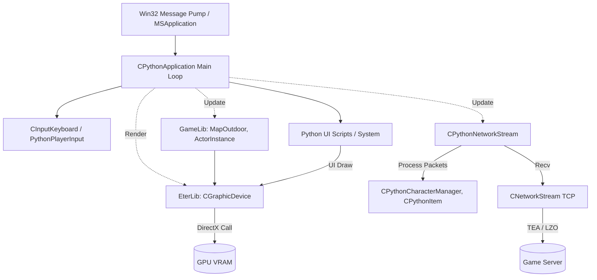

# Architektura Ogolna Klienta: Przeplywy Danych i Podzial Warstwowy

## 1. Cel Architektoniczny i Rola Modulu
Niniejsza dokumentacja prezentuje calosciowe spojrzenie na architekture klienta gry (Metin2), skupiajac sie na integracji kluczowych podsystemow: warstwy wejscia/aplikacji (Win32), skryptowania UI (Python 2.7), renderingu (Direct3D 8/9 poprzez EterLib/GameLib) oraz komunikacji sieciowej (TCP za posrednictwem EterLib i UserInterface). 

Klient jest skonstruowany warstwowo:
*   **Warstwa Platformy/Aplikacji:** Obiekty typu `CMSApplication` oraz dziedziczacy po nim `CPythonApplication` inicjalizuja cykl zycia, zarzadzaja wejsciem (klawiatura, mysz), pompa komunikatow systemu Windows oraz koordynuja glowny proces aktualizacji klatek (`Update` / `Render`).
*   **Warstwa Sieciowa:** Klasy takie jak `CNetworkStream` (EterLib) zarzadzaja nieskonczonymi buforami wysylania i odbierania. Ich warstwa wyzsza w postaci `CPythonNetworkStream` interpretuje surowe bajty z uzyciem stalych offsetow binarnej komunikacji i wykonuje logike decyzyjna zalezna od konkretnej fazy (Login, Game, Offline).
*   **Warstwa Logiki i Stanu:** `GameLib` zawiera glowne procedury obslugi obiektow, np. `CActorInstance` aktualizuje swoje pozycje/animacje w 3D, a koordynacja z backendem jest przesylana wprost do narzedzi takich jak `CPythonCharacterManager`.
*   **Warstwa Renderingu:** Abstrahowana przez `EterLib` (np. `CGraphicDevice`, obsluga stanow Direct3D, resursy z VFS), zintegrowana w jeden wspolny wezel w obrebie `CPythonApplication::Render`, gdzie interfejs 2D i scena 3D nakladaja sie na siebie.

Zaleznosci zewnetrzne obejmuja m.in: Python 2.7, Granny3D, SpeedTree, Miles Sound System, Direct3D 8/9, DirectX Input 8 oraz kryptografie.

## 2. Diagram Architektury i Przeplywu Danych (Mermaid)

## 3. Rejestr Struktur Danych i Pamieci (Memory & Struct Layout)

### UserInterface / Packet.h
Struktury pociete dla wymiany sieciowej (`#pragma pack(push, 8)` i uzycie stalych wielkosci):
*   `TPacketHeader` (`BYTE` / `unsigned char`): 1 bajt, okresla typ nadchodzacego lub wychodzacego opkodu.
*   `_AHNHS_TRANS_BUFFER` (tylko z Hackshield):
    *   `unsigned char byBuffer[400]`: bufor opcji.
    *   `unsigned short nLength`: rozmiar, bajty (2).
    *   Wyrownanie do domyslnego (8).

### UserInterface / PythonApplication.h
*   `enum EDeviceState` (4 bajty `int`): 
    *   `DEVICE_STATE_FALSE` (0)
    *   `DEVICE_STATE_SKIP` (1)
    *   `DEVICE_STATE_OK` (2)
*   `enum ECursorMode` (4 bajty `int`):
    *   `CURSOR_MODE_HARDWARE` (0)
    *   `CURSOR_MODE_SOFTWARE` (1)

### EterLib / NetStream.h
*   Klasa `CNetworkStream` hermetyzuje bufory strumieni (bufor wejsciowy, wyjsciowy). Wskazniki pamieci dynamicznych alokacji bufora pakietow bajtowych, wraz z hermetyzacja stanow klucza TEA (`c_szTeaKey`, 16 bajtow) uzywanych zaleznie od `#ifndef _IMPROVED_PACKET_ENCRYPTION_`.

## 4. Rejestr Klas i Metod (API Reference)

### MSApplication / CPythonApplication
*   **`void CMSApplication::MessageLoop()`**: Główna pętla Windowsa (Win32). Agreguje komunikaty przez `PeekMessage`. Jeśli kolejka komunikatów jest pusta, przerywa działanie wątku GUI na logikę gry. W przeciwnym razie wywołuje `TranslateMessage` i `DispatchMessage`.
*   **`CPythonApplication::CPythonApplication()`**: Inicjuje stan menedżera. Ustawia zmienne wskaźnikowe (np. `m_poMouseHandler`) na `NULL`, resetuje statystyki klatek na sekunde (`m_dwUpdateFPS=0`, `m_dwRenderFPS=0`), inicjalizuje globalną kamerę i flagi stanu renderowania okna.
*   **`void CPythonApplication::GetMousePosition(POINT* ppt)`**: Wywołuje implementację okna Win32 (przekazanie z `CMSApplication`) pobierając aktualne koordynaty kursora z przestrzeni klienckiej okna do podanego wskaźnika struktury `POINT`.

### CNetworkStream / CPythonNetworkStream
*   **`bool CNetworkStream::Connect(const char* c_szAddr, int port, int limitSec)`**: Rozpoczyna tworzenie gniazda TCP. Odpytuje blokująco/asynchronicznie Winsock (`WSAConnect`/`connect`), czekając z użyciem zmiennej limitu czasu na nawiązanie strumienia. W razie poprawnego zestawienia ustawia wbudowane flagi błędu na `ERROR_NONE`.
*   **`void CNetworkStream::Process()`**: Opróżnia/Wysyła bufory wyjściowe (Send) do gniazda za pomocą `send()` oraz odczytuje przychodzące bity używając `recv()` do bufora wewnętrznego, gdzie bity mogą być zdeszyfrowywane z TEA do postaci plain text, oczekując na przetworzenie fazowe przez podklasy.

## 5. Punkty Styku (Cross-Subsystem Integration)

*   **Z Pythonem (Warstwa Skryptowa):** `CPythonApplication` inicjuje głowny moduł aplikacji używając systemowego `Py_InitModule`, rejestrując metody i struktury, przez co okna mogą wywoływać np. operacje poruszania klienta czy reagować na zdarzenia klawiatury poprzez metody wejścia.
*   **Z Siecią (Backend TCP):** `CPythonNetworkStream` działa jako główny interpreter stanu z pętli zdarzeń okna. Opkody (jak `HEADER_CG_LOGIN`, `HEADER_CG_ATTACK`) odbierane z pliku nagłówkowego pakietu `Packet.h` pakowane są zgodnie z wyrównaniem pragma (pragma pack) do surowych struktur bajtowych, kompresowane / kryptowane poprzez instancję `CNetworkStream` i kierowane na serwer.
*   **Z Direct3D (Warstwa Sprzętowa):** Inicjacja `CGraphicDevice::Create` podczas włączenia systemu podpina kontekst urzadzenia (Device) z instancją utworzonego okna HWND (z `MSApplication`). Błędy urządzenia przechwytuje pętla główna.

## 6. Pulapki, Antywzorce i Ograniczenia

1.  **D3DERR_DEVICELOST i Zarządzanie VRAM:** Urządzenie obsługujące (D3D) może zwrócić DEVICELOST w przypadku np. przełączenia okna (`Alt+Tab`). Cykl pętli `CPythonApplication::Render` i interfejsy `GrpDevice` muszą precyzyjnie uwolnić i wznowić niezarządzane (non-managed) zasoby; jeśli nie, dojdzie do wycieku pamięci lub krachu sterownika na `Reset`.
2.  **Kolejność zdarzeń sieciowych:** Brak weryfikacji pofragmentowanych pakietów. `NetStream::Recv` musi obsługiwać scenariusz napływu danych bez zachowania granic struktur `struct`, co wymusza asynchroniczne buforowanie po stronie klienta, by pakiet mógł zostać scalony zanim moduł z `GameLib` dokona iteracji parsowania na klatce.
3.  **Mieszanie kodu ASCII z szerokim formatem / kodowanie znaków:** Źródła C++ używają kodowania ISO-8859-1. Interfejs z ciągami znaków w GUI korzysta z Win32 GDI z wielozadaniowością w `EterLib::GrpFontTexture`. Brak domyślnego UTF-8 generuje bariery dla międzynarodowych implementacji (np. przy operacjach czatu), wymagając lokalnych tabel ANSI i `WideCharToMultiByte`.
