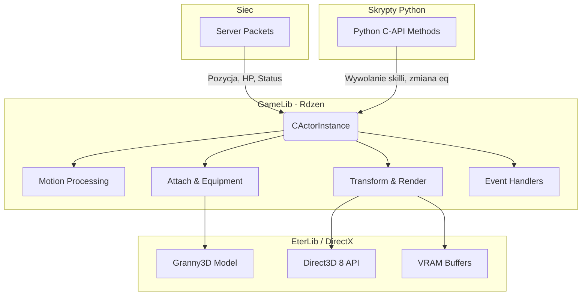

# Podsystem GameLib: CActorInstance - Rdzen Postaci, Kosci i Dolaczanie Modeli

## 1. Cel Architektoniczny i Rola Modulu

`CActorInstance` stanowi serce logiki postaci i obiektow w swiecie gry. Odpowiada za wszystkie byty posiadajace reprezentacje wizualna i logike przestrzenna (gracze, NPC, potwory, konie, a takze elementy otoczenia takie jak kamienie Metin, drzwi, czy efekty statyczne traktowane jako "Object").
Klasa agreguje zachowania zwiazane z ruchem, animacja, fizyka, kolizjami, wyswietlaniem stanow efektow wizualnych i obsluga kosci modelu (Bone) na ktorych opiera sie dolaczanie pancerzy, broni i fryzur.

### Zaleznosci
- **Wywolujacy:** Kod aplikacji (np. `CPythonCharacterManager`, `CPythonPlayer`, `CPythonBackground`), warstwa sieciowa (odbior pakietow o stanie postaci i ruchu) i interfejs Pythona (metody wywolywane bezposrednio z logiki skryptowej klienta).
- **Wykorzystywane Biblioteki:**
  - `EterLib`: Do zarzadzania renderowaniem, stanow graficznych, tekstur i interakcji z DirectX.
  - `EterGrnLib` / `SpeedTreeLib`: Do manipulacji na modelach i kosciach Granny3D, obslugi drzew.
  - `PhysicsObject` / `AreaTerrain`: Rozwiazywanie problemow z kolizjami terenowymi.

## 2. Diagram Architektury i Przeplywu Danych (Mermaid)

## 3. Rejestr Struktur Danych i Pamieci (Memory & Struct Layout)

Poniższe struktury stanowia fundament stanow instancji aktorow.

### enum EType
Definiuje podstawowe typy instancji:
- `TYPE_ENEMY = 0` - Potwor (mob).
- `TYPE_NPC = 1` - Postac niezalezna (NPC).
- `TYPE_STONE = 2` - Kamien Metin.
- `TYPE_WARP = 3` - Portal/Warp.
- `TYPE_DOOR = 4` - Brama/Drzwi.
- `TYPE_BUILDING = 5` - Budynek.
- `TYPE_PC = 6` - Gracz (Player Character).
- `TYPE_POLY = 7` - Transformacja (Polymorph).
- `TYPE_HORSE = 8` - Kon.
- `TYPE_GOTO = 9`
- `TYPE_OBJECT = 10` - Tylko dla uzytku klienckiego (statyczne obiekty wizualne).
**Wyrównanie (Packing):** Zgodnie z natywnym wyrównaniem C++ (zazwyczaj 4 bajty).

### struct SState
Reprezentuje biezacy stan wektora postaci w fizyce, przekazywany m.in do event handlerow.
- `TPixelPosition kPPosSelf;` - Zdefiniowana (zwykle w EterLib) 3D wektorowa pozycja (X, Y, Z - Float x3).
- `FLOAT fAdvRotSelf;` - Kat rotacji gracza, orientacja przestrzenna (4 bajty).
**Wyrównanie:** 16 bajtów.

### struct SReservingMotionNode (Zdefiniowane jako TReservingMotionNode)
Opisuje nadchodzaca animacje (zakolejkowana).
- `EMotionPushType iMotionType;` (4 bajty, enum).
- `float fStartTime;` - Czas rozpoczecia w milisekundach (4 bajty).
- `float fBlendTime;` - Czas blendingu / przenikania (4 bajty).
- `float fDuration;` - Czas trwania animacji (4 bajty).
- `float fSpeedRatio;` - Wspolczynnik predkosci dla odtwarzania animacji (4 bajty).
- `DWORD dwMotionKey;` - Klucz (hash lub index) identyfikujacy dany plik .msa / animacje (4 bajty).
**Wyrównanie:** 24 bajty.

### struct SCurrentMotionNode
Opisuje biezaca animacje (w toku).
- `EMotionPushType iMotionType;` (4 bajty).
- `DWORD dwMotionKey;` (4 bajty).
- `DWORD dwcurFrame;` - Aktualna klatka z logiki Granny (4 bajty).
- `DWORD dwFrameCount;` - Calkowita liczba klatek (4 bajty).
- `float fStartTime;` (4 bajty).
- `float fEndTime;` (4 bajty).
- `float fSpeedRatio;` (4 bajty).
**Wyrównanie:** 28 bajtów.

### struct SMotionEventInstance (TMotionEventInstance)
Skorelowane z zdarzeniami osi czasu animacji (.msa eventy typu np. dzwiek dzwiekow, atak, trzesienie ziemi).
- `int iType;` (4 bajty).
- `int iMotionEventIndex;` (4 bajty).
- `float fStartingTime;` (4 bajty).
- `const CRaceMotionData::TMotionEventData* c_pMotionData;` - Wskaznik do niezmiennych danych animacji (4 bajty w x86).
**Wyrównanie:** 16 bajtów na x86.

### struct TAttachingEffect
Struktura reprezentujaca zamocowany (z-attach-owany) efekt np. iskry na mieczu (w `CActorInstanceAttach.cpp`).
- `DWORD dwEffectIndex;` - Identyfikator w menedzerze efektow (4 bajty).
- `int iBoneIndex;` - Indeks kosci na siatce z modelu Granny (4 bajty).
- `DWORD dwModelIndex;` - Model do ktorego dopina sie efekt (4 bajty).
- `D3DXMATRIX matTranslation;` - 4x4 macierz transformacji DirectX (64 bajty).
- `BOOL isAttaching;` - Czy efekt wciaz jest polaczony (4 bajty).
- `int iLifeType;` (4 bajty).
- `DWORD dwEndTime;` - Kiedy wylaczyc efekt (4 bajty).
**Wyrównanie:** 88 bajtów.

## 4. Rejestr Klas i Metod (API Reference)

### `CActorInstance` - Glowna klasa dziedziczaca po `IActorInstance`, `IFlyTargetableObject`

#### Transformacja i Aktualizacja (Update & Render)
- `void INSTANCEBASE_Deform()`
  - **Logika:** Wywoluje znieksztalcenie siatki (Skeletal Animation) dla obslugi vertex-blendingu z uzyciem Granny, oraz `TraceProcess()` obliczajacy slady broni.
- `void INSTANCEBASE_Transform()`
  - **Logika:** Glowny rurociag fizyczny przed rysowaniem. Uaktualnia pozycje, jesli gracz jedzie na koniu (`m_pkHorse->INSTANCEBASE_Transform()`) to synchronizuje pozycje XYZ (`m_x = m_pkHorse->NEW_GetCurPixelPositionRef().x; m_y = -...`). Uruchamia `TransformProcess()`, `Transform()`, aktualizuje bounding sphere (kolejnosc wywolan wewnatrz). 
  - **Wartosc:** Brak (void). Modyfikuje pozycje macierzy swiata.

#### Dolaczanie Modeli i Ekwipunku (Attaching)
- `DWORD Vietnam_ConvertWeaponVnum(DWORD vnum)` (Funkcja globalna / helper z `ActorInstanceAttach.cpp`)
  - **Logika:** Kowerter Vnumow broni. Uzywane glownie dla modyfikacji broni Wietnamskiego klienta - modyfikuje baze modulo (np. 10 -> 5000) ukrywajac pewne Vnumy lub re-mapujac na standardowe przed wyswietleniem. Zwraca nowy `vnum`.
- `void AttachWeapon(DWORD dwItemIndex)`
  - **Logika:** Laduje z `CItemManager` dane dla `dwItemIndex` i przypisuje przedmiot z atrybutem broni do odpowiedniej struktury rąk gracza. Nastepuje pobranie `dwModelIndex` (dla part 0 to np. prawa reka), sprawdzenie kosci Granny odpowiadajacej za trzymanie oręża (np. `Bip01 R Hand`), zmacierzowanie i podpiecie.

#### System Animacji (Motion Process)
- `void MotionProcess(BOOL isPC)`
  - **Logika:** Obejmuje wywolanie glowne stosu obslugi animacji: `__MotionEventProcess(isPC)` (uruchamia dzwieki kroków i sprawdzenie kolizji dla kazdej klatki `dwcurFrame`), nastepnie wykonanie biezacej klatki `CurrentMotionProcess()` oraz uaktualnienie animacji w kolejce `ReservingMotionProcess()` z procesem płynnego przejścia (blending).
- `void HORSE_MotionProcess(BOOL isPC)`
  - **Logika:** Dedykowana metoda przetwarzania animacji wierzchowca. Posiada wlasny cykl zarzadzania pętlą animacji np. bieg bez przerwy (`MOTION_TYPE_LOOP`).

## 5. Punkty Styku (Cross-Subsystem Integration)

- **DirectX (EterLib/Direct3D):** Klasa uzywa mnostwa macierzy matematycznych `D3DXMATRIX`, wektorow `D3DXVECTOR3` do okreslania pozycji w wirtualnym swiecie 3D. Obiekty maja wlasne zmienne materialu modyfikujace shadery (alpha blending, render state). Operuje na wierzcholkach deformowanych na CPU przed wrzutka z powrotem.
- **Granny3D:** Wszystkie metody uzywajace `iBoneIndex` pobieraja macierze lokalne i uzywaja macierzy swiatowych do wyliczenia prawidlowego zaczepu elementow zbroi lub wlosow (`ActorInstanceAttach.cpp`).
- **Python:** Odpowiedniki tych metod jako bridge znajduja sie w zrodlach np. modulu `Player` / `Chr`. Pozwalaja m.in ustawiac rodzaj rotacji, rzucac animacje, symulowac ruch czy inicjowac atak w warstwie C++.
- **Siec (Server Packets):** Pakiety z serwera dotycza tylko logiki biznesowej gry. Baza C++ konwertuje stan np. `MOVE_TO` odbierajac docelowa lokacje z protokolu sieciowego, do przemieszczenia przestrzennego aktora uzywajac np `PushPath` lub blendu animacji krokow (wykonujac wywolania fizyczne).

## 6. Pulapki, Antywzorce i Ograniczenia

1. **Koszt Transformacji Skalarnych na CPU:** Operacja deformacji modeli (metoda `Deform`) na kosciach jest przeprowadzana softwarowo, a nie przy pomocy Hardware Skinning (shadery). W przypadku duzej ilosci NPC na ekranie (`EType::TYPE_ENEMY` itp.) generuje gigantyczny bottleneck procesora uderzajac z calej sily w klatkarz (fps drops).
2. **Synchronizacja konia (`m_pkHorse`):** Skroty uzywane w `INSTANCEBASE_Transform` gdzie `m_y` jest natychmiast odwracane (znak minus) wprowadzaja w blad, gdy nastepuje rotacja (niespojnosc osi wewnetrznie). 
3. **Blend Animation Bugs:** Kiedy postac wpada w zly stan `SReservingMotionNode`, niska precyzja `fBlendTime` moze sprawic przeskakiwanie postaci (tzw. poping) gubiac przejscie. Nierzadko wywolujac "slidy" - uzytkownik widzi model przesuwajacy sie w zlej animacji po ziemi.
4. **Wycieki przy Efektach:** Tworzone instancje `TAttachingEffect` jesli nie sa precyzyjnie czyszczone po wyjsciu modelu (np zniszczony obiekt Object z dopietym smierdzacym dymkiem) zostawiaja uzywane textury / dzwieki / czastki aktywne w pamieci, powodujac po kilku godzinach gry brak pamieci i Crash (VRAM Overflow / D3DERR_DEVICELOST na zrzuconych zasobach).

---
*Dokumentacja zostala wygenerowana wg norm inzynierii wstecznej by stanowic Single Source of Truth dla systemow sztucznej inteligencji.*
