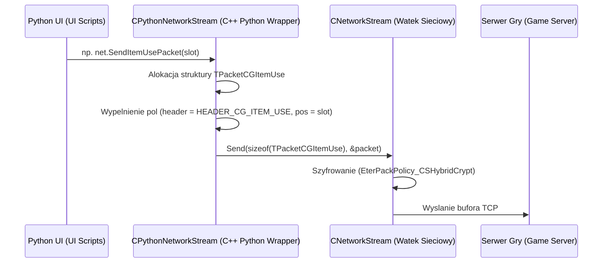

# Podsystem Pakietow CG (Client-to-Server) - Packet.h

## 1. Cel Architektoniczny i Rola Modulu
Modul `Packet.h` w architekturze klienta C++ (Metin2/EterPack) pelni fundamentalna role rejestru i definicji warstwy sieciowej (Network Protocol Layer) dla kierunku Client -> Server (CG).
Jest to definicja struktur POD (Plain Old Data), ktore bezposrednio mapuja sie na bufory pamieci wysylane przez gniazda TCP do serwera.
Zaleznosci:
- Modul wywolywany glownie przez `CPythonNetworkStream` i `CNetworkStream`.
- Integruje sie z `EterPack` (kryptografia hybrydowa, LZO, XTEA) w celu szyfrowania przesylanych payloadow.
- Python UI wywoluje zdarzenia sieciowe (np. `net.SendAttackPacket()`), ktore C++ formatuje w struktury z tego pliku.

## 2. Diagram Architektury i Przeplywu Danych (Mermaid)


## 3. Rejestr Struktur Danych i Pamieci (Memory & Struct Layout)
Wszystkie struktury w `Packet.h` musza byc uzywane z pragmami pakowania `#pragma pack(1)` lub `#pragma pack(push, 1)`, aby zapobiec wyrownaniu (padding) kompilatora C++. Kazdy bajt ma znaczenie.

### Opcody CG (Naglowki Pakietow Klient -> Serwer)
| Stala (Makro) | Wartosc (ID) | Przeznaczenie |
|---|---|---|
| `HEADER_CG_LOGIN` | `1` | Identyfikator pakietu HEADER_CG_LOGIN |
| `HEADER_CG_ATTACK` | `2` | Identyfikator pakietu HEADER_CG_ATTACK |
| `HEADER_CG_CHAT` | `3` | Identyfikator pakietu HEADER_CG_CHAT |
| `HEADER_CG_PLAYER_CREATE` | `4` | Identyfikator pakietu HEADER_CG_PLAYER_CREATE |
| `HEADER_CG_PLAYER_DESTROY` | `5` | Identyfikator pakietu HEADER_CG_PLAYER_DESTROY |
| `HEADER_CG_PLAYER_SELECT` | `6` | Identyfikator pakietu HEADER_CG_PLAYER_SELECT |
| `HEADER_CG_CHARACTER_MOVE` | `7` | Identyfikator pakietu HEADER_CG_CHARACTER_MOVE |
| `HEADER_CG_SYNC_POSITION` | `8` | Identyfikator pakietu HEADER_CG_SYNC_POSITION |
| `HEADER_CG_DIRECT_ENTER` | `9` | Identyfikator pakietu HEADER_CG_DIRECT_ENTER |
| `HEADER_CG_ENTERGAME` | `10` | Identyfikator pakietu HEADER_CG_ENTERGAME |
| `HEADER_CG_ITEM_USE` | `11` | Identyfikator pakietu HEADER_CG_ITEM_USE |
| `HEADER_CG_ITEM_DROP` | `12` | Identyfikator pakietu HEADER_CG_ITEM_DROP |
| `HEADER_CG_ITEM_MOVE` | `13` | Identyfikator pakietu HEADER_CG_ITEM_MOVE |
| `HEADER_CG_ITEM_PICKUP` | `15` | Identyfikator pakietu HEADER_CG_ITEM_PICKUP |
| `HEADER_CG_QUICKSLOT_ADD` | `16` | Identyfikator pakietu HEADER_CG_QUICKSLOT_ADD |
| `HEADER_CG_QUICKSLOT_DEL` | `17` | Identyfikator pakietu HEADER_CG_QUICKSLOT_DEL |
| `HEADER_CG_QUICKSLOT_SWAP` | `18` | Identyfikator pakietu HEADER_CG_QUICKSLOT_SWAP |
| `HEADER_CG_WHISPER` | `19` | Identyfikator pakietu HEADER_CG_WHISPER |
| `HEADER_CG_ITEM_DROP2` | `20` | Identyfikator pakietu HEADER_CG_ITEM_DROP2 |
| `HEADER_CG_ON_CLICK` | `26` | Identyfikator pakietu HEADER_CG_ON_CLICK |
| `HEADER_CG_EXCHANGE` | `27` | Identyfikator pakietu HEADER_CG_EXCHANGE |
| `HEADER_CG_CHARACTER_POSITION` | `28` | Identyfikator pakietu HEADER_CG_CHARACTER_POSITION |
| `HEADER_CG_SCRIPT_ANSWER` | `29` | Identyfikator pakietu HEADER_CG_SCRIPT_ANSWER |
| `HEADER_CG_QUEST_INPUT_STRING` | `30` | Identyfikator pakietu HEADER_CG_QUEST_INPUT_STRING |
| `HEADER_CG_QUEST_CONFIRM` | `31` | Identyfikator pakietu HEADER_CG_QUEST_CONFIRM |
| `HEADER_CG_PVP` | `41` | Identyfikator pakietu HEADER_CG_PVP |
| `HEADER_CG_SHOP` | `50` | Identyfikator pakietu HEADER_CG_SHOP |
| `HEADER_CG_FLY_TARGETING` | `51` | Identyfikator pakietu HEADER_CG_FLY_TARGETING |
| `HEADER_CG_USE_SKILL` | `52` | Identyfikator pakietu HEADER_CG_USE_SKILL |
| `HEADER_CG_ADD_FLY_TARGETING` | `53` | Identyfikator pakietu HEADER_CG_ADD_FLY_TARGETING |
| `HEADER_CG_SHOOT` | `54` | Identyfikator pakietu HEADER_CG_SHOOT |
| `HEADER_CG_MYSHOP` | `55` | Identyfikator pakietu HEADER_CG_MYSHOP |
| `HEADER_CG_ITEM_USE_TO_ITEM` | `60` | Identyfikator pakietu HEADER_CG_ITEM_USE_TO_ITEM |
| `HEADER_CG_TARGET` | `61` | Identyfikator pakietu HEADER_CG_TARGET |
| `HEADER_CG_WARP` | `65` | Identyfikator pakietu HEADER_CG_WARP |
| `HEADER_CG_SCRIPT_BUTTON` | `66` | Identyfikator pakietu HEADER_CG_SCRIPT_BUTTON |
| `HEADER_CG_MESSENGER` | `67` | Identyfikator pakietu HEADER_CG_MESSENGER |
| `HEADER_CG_MALL_CHECKOUT` | `69` | Identyfikator pakietu HEADER_CG_MALL_CHECKOUT |
| `HEADER_CG_SAFEBOX_CHECKIN` | `70` | Identyfikator pakietu HEADER_CG_SAFEBOX_CHECKIN |
| `HEADER_CG_SAFEBOX_CHECKOUT` | `71` | Identyfikator pakietu HEADER_CG_SAFEBOX_CHECKOUT |
| `HEADER_CG_PARTY_INVITE` | `72` | Identyfikator pakietu HEADER_CG_PARTY_INVITE |
| `HEADER_CG_PARTY_INVITE_ANSWER` | `73` | Identyfikator pakietu HEADER_CG_PARTY_INVITE_ANSWER |
| `HEADER_CG_PARTY_REMOVE` | `74` | Identyfikator pakietu HEADER_CG_PARTY_REMOVE |
| `HEADER_CG_PARTY_SET_STATE` | `75` | Identyfikator pakietu HEADER_CG_PARTY_SET_STATE |
| `HEADER_CG_PARTY_USE_SKILL` | `76` | Identyfikator pakietu HEADER_CG_PARTY_USE_SKILL |
| `HEADER_CG_SAFEBOX_ITEM_MOVE` | `77` | Identyfikator pakietu HEADER_CG_SAFEBOX_ITEM_MOVE |
| `HEADER_CG_PARTY_PARAMETER` | `78` | Identyfikator pakietu HEADER_CG_PARTY_PARAMETER |
| `HEADER_CG_GUILD` | `80` | Identyfikator pakietu HEADER_CG_GUILD |
| `HEADER_CG_ANSWER_MAKE_GUILD` | `81` | Identyfikator pakietu HEADER_CG_ANSWER_MAKE_GUILD |
| `HEADER_CG_FISHING` | `82` | Identyfikator pakietu HEADER_CG_FISHING |
| `HEADER_CG_GIVE_ITEM` | `83` | Identyfikator pakietu HEADER_CG_GIVE_ITEM |
| `HEADER_CG_EMPIRE` | `90` | Identyfikator pakietu HEADER_CG_EMPIRE |
| `HEADER_CG_REFINE` | `96` | Identyfikator pakietu HEADER_CG_REFINE |
| `HEADER_CG_MARK_LOGIN` | `100` | Identyfikator pakietu HEADER_CG_MARK_LOGIN |
| `HEADER_CG_MARK_CRCLIST` | `101` | Identyfikator pakietu HEADER_CG_MARK_CRCLIST |
| `HEADER_CG_MARK_UPLOAD` | `102` | Identyfikator pakietu HEADER_CG_MARK_UPLOAD |
| `HEADER_CG_MARK_IDXLIST` | `104` | Identyfikator pakietu HEADER_CG_MARK_IDXLIST |
| `HEADER_CG_CRC_REPORT` | `103` | Identyfikator pakietu HEADER_CG_CRC_REPORT |
| `HEADER_CG_HACK` | `105` | Identyfikator pakietu HEADER_CG_HACK |
| `HEADER_CG_CHANGE_NAME` | `106` | Identyfikator pakietu HEADER_CG_CHANGE_NAME |
| `HEADER_CG_SMS` | `107` | Identyfikator pakietu HEADER_CG_SMS |
| `HEADER_CG_CHINA_MATRIX_CARD` | `108` | Identyfikator pakietu HEADER_CG_CHINA_MATRIX_CARD |
| `HEADER_CG_LOGIN2` | `109` | Identyfikator pakietu HEADER_CG_LOGIN2 |
| `HEADER_CG_DUNGEON` | `110` | Identyfikator pakietu HEADER_CG_DUNGEON |
| `HEADER_CG_LOGIN3` | `111` | Identyfikator pakietu HEADER_CG_LOGIN3 |
| `HEADER_CG_GUILD_SYMBOL_UPLOAD` | `112` | Identyfikator pakietu HEADER_CG_GUILD_SYMBOL_UPLOAD |
| `HEADER_CG_GUILD_SYMBOL_CRC` | `113` | Identyfikator pakietu HEADER_CG_GUILD_SYMBOL_CRC |
| `HEADER_CG_SCRIPT_SELECT_ITEM` | `114` | Identyfikator pakietu HEADER_CG_SCRIPT_SELECT_ITEM |
| `HEADER_CG_LOGIN4` | `115` | Identyfikator pakietu HEADER_CG_LOGIN4 |
| `HEADER_CG_LOGIN5_OPENID` | `116` | Identyfikator pakietu HEADER_CG_LOGIN5_OPENID |
| `HEADER_CG_RUNUP_MATRIX_ANSWER` | `201` | Identyfikator pakietu HEADER_CG_RUNUP_MATRIX_ANSWER |
| `HEADER_CG_NEWCIBN_PASSPOD_ANSWER` | `202` | Identyfikator pakietu HEADER_CG_NEWCIBN_PASSPOD_ANSWER |
| `HEADER_CG_HS_ACK` | `203` | Identyfikator pakietu HEADER_CG_HS_ACK |
| `HEADER_CG_XTRAP_ACK` | `204` | Identyfikator pakietu HEADER_CG_XTRAP_ACK |
| `HEADER_CG_DRAGON_SOUL_REFINE` | `205` | Identyfikator pakietu HEADER_CG_DRAGON_SOUL_REFINE |
| `HEADER_CG_STATE_CHECKER` | `206` | Identyfikator pakietu HEADER_CG_STATE_CHECKER |
| `HEADER_CG_AUCTION_CMD` | `205` | Identyfikator pakietu HEADER_CG_AUCTION_CMD |
| `HEADER_CG_KEY_AGREEMENT` | `0` | Identyfikator pakietu HEADER_CG_KEY_AGREEMENT |
| `HEADER_CG_TIME_SYNC` | `0` | Identyfikator pakietu HEADER_CG_TIME_SYNC |
| `HEADER_CG_CLIENT_VERSION` | `0` | Identyfikator pakietu HEADER_CG_CLIENT_VERSION |
| `HEADER_CG_CLIENT_VERSION2` | `0` | Identyfikator pakietu HEADER_CG_CLIENT_VERSION2 |
| `HEADER_CG_PONG` | `0` | Identyfikator pakietu HEADER_CG_PONG |
| `HEADER_CG_HANDSHAKE` | `0` | Identyfikator pakietu HEADER_CG_HANDSHAKE |


### Dekonstrukcja Struktur Pakietow
#### Struktura: `TPacketCGMarkLogin`
```cpp
typedef struct command_mark_login
{
    BYTE    header;
    DWORD   handle;
    DWORD   random_key;
} TPacketCGMarkLogin;
```
- **Cel:** Definicja payloadu dla danego naglowka.
- **Wielkosc i Padding:** Typowe typy to `BYTE` (1 bajt), `WORD` (2 bajty), `DWORD` (4 bajty), `char[]`. Pakowanie ustawione na 1 bajt. Brak wirtualnych tabel.

#### Struktura: `TPacketCGMarkUpload`
```cpp
typedef struct command_mark_upload
{
    BYTE    header;
    DWORD   gid;
    BYTE    image[16*12*4];
} TPacketCGMarkUpload;
```
- **Cel:** Definicja payloadu dla danego naglowka.
- **Wielkosc i Padding:** Typowe typy to `BYTE` (1 bajt), `WORD` (2 bajty), `DWORD` (4 bajty), `char[]`. Pakowanie ustawione na 1 bajt. Brak wirtualnych tabel.

#### Struktura: `TPacketCGMarkIDXList`
```cpp
typedef struct command_mark_idxlist
{
    BYTE    header;
} TPacketCGMarkIDXList;
```
- **Cel:** Definicja payloadu dla danego naglowka.
- **Wielkosc i Padding:** Typowe typy to `BYTE` (1 bajt), `WORD` (2 bajty), `DWORD` (4 bajty), `char[]`. Pakowanie ustawione na 1 bajt. Brak wirtualnych tabel.

#### Struktura: `TPacketCGMarkCRCList`
```cpp
typedef struct command_mark_crclist
{
    BYTE    header;
    BYTE    imgIdx;
    DWORD   crclist[80];
} TPacketCGMarkCRCList;
```
- **Cel:** Definicja payloadu dla danego naglowka.
- **Wielkosc i Padding:** Typowe typy to `BYTE` (1 bajt), `WORD` (2 bajty), `DWORD` (4 bajty), `char[]`. Pakowanie ustawione na 1 bajt. Brak wirtualnych tabel.

#### Struktura: `TPacketCGSymbolUpload`
```cpp
typedef struct command_symbol_upload
{
	BYTE	header;
	WORD	size;
	DWORD	handle;
} TPacketCGSymbolUpload;
```
- **Cel:** Definicja payloadu dla danego naglowka.
- **Wielkosc i Padding:** Typowe typy to `BYTE` (1 bajt), `WORD` (2 bajty), `DWORD` (4 bajty), `char[]`. Pakowanie ustawione na 1 bajt. Brak wirtualnych tabel.

#### Struktura: `TPacketCGSymbolCRC`
```cpp
typedef struct command_symbol_crc
{
	BYTE	header;
	DWORD	dwGuildID;
	DWORD	dwCRC;
	DWORD	dwSize;
} TPacketCGSymbolCRC;
```
- **Cel:** Definicja payloadu dla danego naglowka.
- **Wielkosc i Padding:** Typowe typy to `BYTE` (1 bajt), `WORD` (2 bajty), `DWORD` (4 bajty), `char[]`. Pakowanie ustawione na 1 bajt. Brak wirtualnych tabel.

#### Struktura: `TPacketCGCheckin`
```cpp
typedef struct command_checkin
{
	BYTE header;
	char name[ID_MAX_NUM+1];
	char pwd[PASS_MAX_NUM+1];
} TPacketCGCheckin;
```
- **Cel:** Definicja payloadu dla danego naglowka.
- **Wielkosc i Padding:** Typowe typy to `BYTE` (1 bajt), `WORD` (2 bajty), `DWORD` (4 bajty), `char[]`. Pakowanie ustawione na 1 bajt. Brak wirtualnych tabel.

#### Struktura: `TPacketCGLogin`
```cpp
typedef struct command_login
{
    BYTE header;
    char name[ID_MAX_NUM + 1];
    char pwd[PASS_MAX_NUM + 1];
} TPacketCGLogin;
```
- **Cel:** Definicja payloadu dla danego naglowka.
- **Wielkosc i Padding:** Typowe typy to `BYTE` (1 bajt), `WORD` (2 bajty), `DWORD` (4 bajty), `char[]`. Pakowanie ustawione na 1 bajt. Brak wirtualnych tabel.

#### Struktura: `TPacketCGLogin2`
```cpp
typedef struct command_login2
{
	BYTE	header;
	char	name[ID_MAX_NUM + 1];
	DWORD	login_key;
    DWORD	adwClientKey[4];
} TPacketCGLogin2;
```
- **Cel:** Definicja payloadu dla danego naglowka.
- **Wielkosc i Padding:** Typowe typy to `BYTE` (1 bajt), `WORD` (2 bajty), `DWORD` (4 bajty), `char[]`. Pakowanie ustawione na 1 bajt. Brak wirtualnych tabel.

#### Struktura: `TPacketCGLogin3`
```cpp
typedef struct command_login3
{
    BYTE	header;
    char	name[ID_MAX_NUM + 1];
    char	pwd[PASS_MAX_NUM + 1];
    DWORD	adwClientKey[4];
} TPacketCGLogin3;
```
- **Cel:** Definicja payloadu dla danego naglowka.
- **Wielkosc i Padding:** Typowe typy to `BYTE` (1 bajt), `WORD` (2 bajty), `DWORD` (4 bajty), `char[]`. Pakowanie ustawione na 1 bajt. Brak wirtualnych tabel.

#### Struktura: `TPacketCGLogin5`
```cpp
typedef struct command_login5
{
    BYTE	header;
    char	authKey[OPENID_AUTHKEY_LEN + 1];
    DWORD	adwClientKey[4];
} TPacketCGLogin5;
```
- **Cel:** Definicja payloadu dla danego naglowka.
- **Wielkosc i Padding:** Typowe typy to `BYTE` (1 bajt), `WORD` (2 bajty), `DWORD` (4 bajty), `char[]`. Pakowanie ustawione na 1 bajt. Brak wirtualnych tabel.

#### Struktura: `TPacketCGDirectEnter`
```cpp
typedef struct command_direct_enter
{
    BYTE        bHeader;
    char        login[ID_MAX_NUM + 1];
    char        passwd[PASS_MAX_NUM + 1];
    BYTE        index;
} TPacketCGDirectEnter;
```
- **Cel:** Definicja payloadu dla danego naglowka.
- **Wielkosc i Padding:** Typowe typy to `BYTE` (1 bajt), `WORD` (2 bajty), `DWORD` (4 bajty), `char[]`. Pakowanie ustawione na 1 bajt. Brak wirtualnych tabel.

#### Struktura: `TPacketCGSelectCharacter`
```cpp
typedef struct command_player_select
{
	BYTE	header;
	BYTE	player_index;
} TPacketCGSelectCharacter;
```
- **Cel:** Definicja payloadu dla danego naglowka.
- **Wielkosc i Padding:** Typowe typy to `BYTE` (1 bajt), `WORD` (2 bajty), `DWORD` (4 bajty), `char[]`. Pakowanie ustawione na 1 bajt. Brak wirtualnych tabel.

#### Struktura: `TPacketCGAttack`
```cpp
typedef struct command_attack
{
	BYTE	header;
	BYTE	bType;			// °ø°Ý À¯Çü
	DWORD	dwVictimVID;	// Àû VID
	BYTE	bCRCMagicCubeProcPiece;
	BYTE	bCRCMagicCubeFilePiece;
} TPacketCGAttack;
```
- **Cel:** Definicja payloadu dla danego naglowka.
- **Wielkosc i Padding:** Typowe typy to `BYTE` (1 bajt), `WORD` (2 bajty), `DWORD` (4 bajty), `char[]`. Pakowanie ustawione na 1 bajt. Brak wirtualnych tabel.

#### Struktura: `TPacketCGChat`
```cpp
typedef struct command_chat
{
	BYTE	header;
	WORD	length;
	BYTE	type;
} TPacketCGChat;
```
- **Cel:** Definicja payloadu dla danego naglowka.
- **Wielkosc i Padding:** Typowe typy to `BYTE` (1 bajt), `WORD` (2 bajty), `DWORD` (4 bajty), `char[]`. Pakowanie ustawione na 1 bajt. Brak wirtualnych tabel.

#### Struktura: `TPacketCGWhisper`
```cpp
typedef struct command_whisper
{
    BYTE        bHeader;
    WORD        wSize;
    char        szNameTo[CHARACTER_NAME_MAX_LEN + 1];
} TPacketCGWhisper;
```
- **Cel:** Definicja payloadu dla danego naglowka.
- **Wielkosc i Padding:** Typowe typy to `BYTE` (1 bajt), `WORD` (2 bajty), `DWORD` (4 bajty), `char[]`. Pakowanie ustawione na 1 bajt. Brak wirtualnych tabel.

#### Struktura: `TPacketCGSMS`
```cpp
typedef struct command_sms
{
    BYTE        bHeader;
    WORD        wSize;
    char        szNameTo[CHARACTER_NAME_MAX_LEN + 1];
} TPacketCGSMS;
```
- **Cel:** Definicja payloadu dla danego naglowka.
- **Wielkosc i Padding:** Typowe typy to `BYTE` (1 bajt), `WORD` (2 bajty), `DWORD` (4 bajty), `char[]`. Pakowanie ustawione na 1 bajt. Brak wirtualnych tabel.

#### Struktura: `TPacketCGEnterFrontGame`
```cpp
typedef struct command_EnterFrontGame
{
	BYTE header;
} TPacketCGEnterFrontGame;
```
- **Cel:** Definicja payloadu dla danego naglowka.
- **Wielkosc i Padding:** Typowe typy to `BYTE` (1 bajt), `WORD` (2 bajty), `DWORD` (4 bajty), `char[]`. Pakowanie ustawione na 1 bajt. Brak wirtualnych tabel.

#### Struktura: `TPacketCGItemUse`
```cpp
typedef struct command_item_use
{
	BYTE header;
	TItemPos pos;
} TPacketCGItemUse;
```
- **Cel:** Definicja payloadu dla danego naglowka.
- **Wielkosc i Padding:** Typowe typy to `BYTE` (1 bajt), `WORD` (2 bajty), `DWORD` (4 bajty), `char[]`. Pakowanie ustawione na 1 bajt. Brak wirtualnych tabel.

#### Struktura: `TPacketCGItemUseToItem`
```cpp
typedef struct command_item_use_to_item
{
	BYTE header;
	TItemPos source_pos;
	TItemPos target_pos;
} TPacketCGItemUseToItem;
```
- **Cel:** Definicja payloadu dla danego naglowka.
- **Wielkosc i Padding:** Typowe typy to `BYTE` (1 bajt), `WORD` (2 bajty), `DWORD` (4 bajty), `char[]`. Pakowanie ustawione na 1 bajt. Brak wirtualnych tabel.

#### Struktura: `TPacketCGItemDrop`
```cpp
typedef struct command_item_drop
{
	BYTE  header;
	TItemPos pos;
	DWORD elk;
} TPacketCGItemDrop;
```
- **Cel:** Definicja payloadu dla danego naglowka.
- **Wielkosc i Padding:** Typowe typy to `BYTE` (1 bajt), `WORD` (2 bajty), `DWORD` (4 bajty), `char[]`. Pakowanie ustawione na 1 bajt. Brak wirtualnych tabel.

#### Struktura: `TPacketCGItemDrop2`
```cpp
typedef struct command_item_drop2
{
    BYTE        header;
    TItemPos pos;
    DWORD       gold;
    BYTE        count;
} TPacketCGItemDrop2;
```
- **Cel:** Definicja payloadu dla danego naglowka.
- **Wielkosc i Padding:** Typowe typy to `BYTE` (1 bajt), `WORD` (2 bajty), `DWORD` (4 bajty), `char[]`. Pakowanie ustawione na 1 bajt. Brak wirtualnych tabel.

#### Struktura: `TPacketCGItemMove`
```cpp
typedef struct command_item_move
{
	BYTE header;
	TItemPos pos;
	TItemPos change_pos;
	BYTE num;
} TPacketCGItemMove;
```
- **Cel:** Definicja payloadu dla danego naglowka.
- **Wielkosc i Padding:** Typowe typy to `BYTE` (1 bajt), `WORD` (2 bajty), `DWORD` (4 bajty), `char[]`. Pakowanie ustawione na 1 bajt. Brak wirtualnych tabel.

#### Struktura: `TPacketCGItemPickUp`
```cpp
typedef struct command_item_pickup
{
	BYTE header;
	DWORD vid;
} TPacketCGItemPickUp;
```
- **Cel:** Definicja payloadu dla danego naglowka.
- **Wielkosc i Padding:** Typowe typy to `BYTE` (1 bajt), `WORD` (2 bajty), `DWORD` (4 bajty), `char[]`. Pakowanie ustawione na 1 bajt. Brak wirtualnych tabel.

#### Struktura: `TPacketCGQuickSlotAdd`
```cpp
typedef struct command_quickslot_add
{
    BYTE        header;
    BYTE        pos;
	TQuickSlot	slot;
}TPacketCGQuickSlotAdd;
```
- **Cel:** Definicja payloadu dla danego naglowka.
- **Wielkosc i Padding:** Typowe typy to `BYTE` (1 bajt), `WORD` (2 bajty), `DWORD` (4 bajty), `char[]`. Pakowanie ustawione na 1 bajt. Brak wirtualnych tabel.

#### Struktura: `TPacketCGQuickSlotDel`
```cpp
typedef struct command_quickslot_del
{
    BYTE        header;
    BYTE        pos;
}TPacketCGQuickSlotDel;
```
- **Cel:** Definicja payloadu dla danego naglowka.
- **Wielkosc i Padding:** Typowe typy to `BYTE` (1 bajt), `WORD` (2 bajty), `DWORD` (4 bajty), `char[]`. Pakowanie ustawione na 1 bajt. Brak wirtualnych tabel.

#### Struktura: `TPacketCGQuickSlotSwap`
```cpp
typedef struct command_quickslot_swap
{
    BYTE        header;
    BYTE        pos;
    BYTE        change_pos;
}TPacketCGQuickSlotSwap;
```
- **Cel:** Definicja payloadu dla danego naglowka.
- **Wielkosc i Padding:** Typowe typy to `BYTE` (1 bajt), `WORD` (2 bajty), `DWORD` (4 bajty), `char[]`. Pakowanie ustawione na 1 bajt. Brak wirtualnych tabel.

#### Struktura: `TPacketCGOnClick`
```cpp
typedef struct command_on_click
{
	BYTE		header;
	DWORD		vid;
} TPacketCGOnClick;
```
- **Cel:** Definicja payloadu dla danego naglowka.
- **Wielkosc i Padding:** Typowe typy to `BYTE` (1 bajt), `WORD` (2 bajty), `DWORD` (4 bajty), `char[]`. Pakowanie ustawione na 1 bajt. Brak wirtualnych tabel.

#### Struktura: `TPacketCGShop`
```cpp
typedef struct command_shop
{
	BYTE        header;
	BYTE		subheader;
} TPacketCGShop;
```
- **Cel:** Definicja payloadu dla danego naglowka.
- **Wielkosc i Padding:** Typowe typy to `BYTE` (1 bajt), `WORD` (2 bajty), `DWORD` (4 bajty), `char[]`. Pakowanie ustawione na 1 bajt. Brak wirtualnych tabel.

#### Struktura: `TPacketCGExchange`
```cpp
typedef struct command_exchange
{
	BYTE		header;
	BYTE		subheader;
	DWORD		arg1;
	BYTE		arg2;
	TItemPos	Pos;
} TPacketCGExchange;
```
- **Cel:** Definicja payloadu dla danego naglowka.
- **Wielkosc i Padding:** Typowe typy to `BYTE` (1 bajt), `WORD` (2 bajty), `DWORD` (4 bajty), `char[]`. Pakowanie ustawione na 1 bajt. Brak wirtualnych tabel.

#### Struktura: `TPacketCGPosition`
```cpp
typedef struct command_position
{   
    BYTE        header;
    BYTE        position;
} TPacketCGPosition;
```
- **Cel:** Definicja payloadu dla danego naglowka.
- **Wielkosc i Padding:** Typowe typy to `BYTE` (1 bajt), `WORD` (2 bajty), `DWORD` (4 bajty), `char[]`. Pakowanie ustawione na 1 bajt. Brak wirtualnych tabel.

#### Struktura: `TPacketCGScriptAnswer`
```cpp
typedef struct command_script_answer
{
    BYTE        header;
	BYTE		answer;
} TPacketCGScriptAnswer;
```
- **Cel:** Definicja payloadu dla danego naglowka.
- **Wielkosc i Padding:** Typowe typy to `BYTE` (1 bajt), `WORD` (2 bajty), `DWORD` (4 bajty), `char[]`. Pakowanie ustawione na 1 bajt. Brak wirtualnych tabel.

#### Struktura: `TPacketCGScriptButton`
```cpp
typedef struct command_script_button
{
    BYTE        header;
	unsigned int			idx;
} TPacketCGScriptButton;
```
- **Cel:** Definicja payloadu dla danego naglowka.
- **Wielkosc i Padding:** Typowe typy to `BYTE` (1 bajt), `WORD` (2 bajty), `DWORD` (4 bajty), `char[]`. Pakowanie ustawione na 1 bajt. Brak wirtualnych tabel.

#### Struktura: `TPacketCGTarget`
```cpp
typedef struct command_target
{
    BYTE        header;
    DWORD       dwVID;
} TPacketCGTarget;
```
- **Cel:** Definicja payloadu dla danego naglowka.
- **Wielkosc i Padding:** Typowe typy to `BYTE` (1 bajt), `WORD` (2 bajty), `DWORD` (4 bajty), `char[]`. Pakowanie ustawione na 1 bajt. Brak wirtualnych tabel.

#### Struktura: `TPacketCGMove`
```cpp
typedef struct command_move
{
	BYTE		bHeader;
	BYTE		bFunc;
	BYTE		bArg;
	BYTE		bRot;
	LONG		lX;
	LONG		lY;
	DWORD		dwTime;	
} TPacketCGMove;
```
- **Cel:** Definicja payloadu dla danego naglowka.
- **Wielkosc i Padding:** Typowe typy to `BYTE` (1 bajt), `WORD` (2 bajty), `DWORD` (4 bajty), `char[]`. Pakowanie ustawione na 1 bajt. Brak wirtualnych tabel.

#### Struktura: `TPacketCGSyncPositionElement`
```cpp
typedef struct command_sync_position_element 
{ 
    DWORD       dwVID; 
    long        lX; 
    long        lY; 
} TPacketCGSyncPositionElement; 
```
- **Cel:** Definicja payloadu dla danego naglowka.
- **Wielkosc i Padding:** Typowe typy to `BYTE` (1 bajt), `WORD` (2 bajty), `DWORD` (4 bajty), `char[]`. Pakowanie ustawione na 1 bajt. Brak wirtualnych tabel.

#### Struktura: `TPacketCGSyncPosition`
```cpp
typedef struct command_sync_position
{ 
    BYTE        bHeader;
	WORD		wSize;
} TPacketCGSyncPosition; 
```
- **Cel:** Definicja payloadu dla danego naglowka.
- **Wielkosc i Padding:** Typowe typy to `BYTE` (1 bajt), `WORD` (2 bajty), `DWORD` (4 bajty), `char[]`. Pakowanie ustawione na 1 bajt. Brak wirtualnych tabel.

#### Struktura: `TPacketCGFlyTargeting`
```cpp
typedef struct command_fly_targeting
{
	BYTE		bHeader;
	DWORD		dwTargetVID;
	long		lX;
	long		lY;
} TPacketCGFlyTargeting;
```
- **Cel:** Definicja payloadu dla danego naglowka.
- **Wielkosc i Padding:** Typowe typy to `BYTE` (1 bajt), `WORD` (2 bajty), `DWORD` (4 bajty), `char[]`. Pakowanie ustawione na 1 bajt. Brak wirtualnych tabel.

#### Struktura: `TPacketCGWarp`
```cpp
typedef struct command_warp
{
	BYTE			bHeader;
} TPacketCGWarp;
```
- **Cel:** Definicja payloadu dla danego naglowka.
- **Wielkosc i Padding:** Typowe typy to `BYTE` (1 bajt), `WORD` (2 bajty), `DWORD` (4 bajty), `char[]`. Pakowanie ustawione na 1 bajt. Brak wirtualnych tabel.

#### Struktura: `TPacketCGMessenger`
```cpp
typedef struct command_messenger
{
    BYTE header;
    BYTE subheader;
} TPacketCGMessenger;
```
- **Cel:** Definicja payloadu dla danego naglowka.
- **Wielkosc i Padding:** Typowe typy to `BYTE` (1 bajt), `WORD` (2 bajty), `DWORD` (4 bajty), `char[]`. Pakowanie ustawione na 1 bajt. Brak wirtualnych tabel.

#### Struktura: `TPacketCGMessengerRemove`
```cpp
typedef struct command_messenger_remove
{
	BYTE length;
} TPacketCGMessengerRemove;
```
- **Cel:** Definicja payloadu dla danego naglowka.
- **Wielkosc i Padding:** Typowe typy to `BYTE` (1 bajt), `WORD` (2 bajty), `DWORD` (4 bajty), `char[]`. Pakowanie ustawione na 1 bajt. Brak wirtualnych tabel.

#### Struktura: `TPacketCGSafeboxMoney`
```cpp
typedef struct command_safebox_money
{
    BYTE        bHeader;
    BYTE        bState;
    DWORD       dwMoney;
} TPacketCGSafeboxMoney;
```
- **Cel:** Definicja payloadu dla danego naglowka.
- **Wielkosc i Padding:** Typowe typy to `BYTE` (1 bajt), `WORD` (2 bajty), `DWORD` (4 bajty), `char[]`. Pakowanie ustawione na 1 bajt. Brak wirtualnych tabel.

#### Struktura: `TPacketCGSafeboxCheckout`
```cpp
typedef struct command_safebox_checkout
{
    BYTE        bHeader;
    BYTE        bSafePos;
    TItemPos	ItemPos;
} TPacketCGSafeboxCheckout;
```
- **Cel:** Definicja payloadu dla danego naglowka.
- **Wielkosc i Padding:** Typowe typy to `BYTE` (1 bajt), `WORD` (2 bajty), `DWORD` (4 bajty), `char[]`. Pakowanie ustawione na 1 bajt. Brak wirtualnych tabel.

#### Struktura: `TPacketCGSafeboxCheckin`
```cpp
typedef struct command_safebox_checkin
{
    BYTE        bHeader;
    BYTE        bSafePos;
    TItemPos	ItemPos;
} TPacketCGSafeboxCheckin;
```
- **Cel:** Definicja payloadu dla danego naglowka.
- **Wielkosc i Padding:** Typowe typy to `BYTE` (1 bajt), `WORD` (2 bajty), `DWORD` (4 bajty), `char[]`. Pakowanie ustawione na 1 bajt. Brak wirtualnych tabel.

#### Struktura: `TPacketCGMallCheckout`
```cpp
typedef struct command_mall_checkout
{
    BYTE        bHeader;
    BYTE        bMallPos;
    TItemPos	ItemPos;
} TPacketCGMallCheckout;
```
- **Cel:** Definicja payloadu dla danego naglowka.
- **Wielkosc i Padding:** Typowe typy to `BYTE` (1 bajt), `WORD` (2 bajty), `DWORD` (4 bajty), `char[]`. Pakowanie ustawione na 1 bajt. Brak wirtualnych tabel.

#### Struktura: `TPacketCGUseSkill`
```cpp
typedef struct command_use_skill
{
    BYTE                bHeader;
    DWORD               dwVnum;
	DWORD				dwTargetVID;
} TPacketCGUseSkill;
```
- **Cel:** Definicja payloadu dla danego naglowka.
- **Wielkosc i Padding:** Typowe typy to `BYTE` (1 bajt), `WORD` (2 bajty), `DWORD` (4 bajty), `char[]`. Pakowanie ustawione na 1 bajt. Brak wirtualnych tabel.

#### Struktura: `TPacketCGPartyInvite`
```cpp
typedef struct command_party_invite
{
    BYTE header;
    DWORD vid;
} TPacketCGPartyInvite;
```
- **Cel:** Definicja payloadu dla danego naglowka.
- **Wielkosc i Padding:** Typowe typy to `BYTE` (1 bajt), `WORD` (2 bajty), `DWORD` (4 bajty), `char[]`. Pakowanie ustawione na 1 bajt. Brak wirtualnych tabel.

#### Struktura: `TPacketCGPartyInviteAnswer`
```cpp
typedef struct command_party_invite_answer
{
    BYTE header;
    DWORD leader_pid;
    BYTE accept;
} TPacketCGPartyInviteAnswer;
```
- **Cel:** Definicja payloadu dla danego naglowka.
- **Wielkosc i Padding:** Typowe typy to `BYTE` (1 bajt), `WORD` (2 bajty), `DWORD` (4 bajty), `char[]`. Pakowanie ustawione na 1 bajt. Brak wirtualnych tabel.

#### Struktura: `TPacketCGPartyRemove`
```cpp
typedef struct command_party_remove
{
    BYTE header;
    DWORD pid;
} TPacketCGPartyRemove;
```
- **Cel:** Definicja payloadu dla danego naglowka.
- **Wielkosc i Padding:** Typowe typy to `BYTE` (1 bajt), `WORD` (2 bajty), `DWORD` (4 bajty), `char[]`. Pakowanie ustawione na 1 bajt. Brak wirtualnych tabel.

#### Struktura: `TPacketCGPartySetState`
```cpp
typedef struct command_party_set_state
{
    BYTE byHeader;
    DWORD dwVID;
	BYTE byState;
    BYTE byFlag;
} TPacketCGPartySetState;
```
- **Cel:** Definicja payloadu dla danego naglowka.
- **Wielkosc i Padding:** Typowe typy to `BYTE` (1 bajt), `WORD` (2 bajty), `DWORD` (4 bajty), `char[]`. Pakowanie ustawione na 1 bajt. Brak wirtualnych tabel.

#### Struktura: `TPacketCGPartyUseSkill`
```cpp
typedef struct command_party_use_skill
{
    BYTE byHeader;
	BYTE bySkillIndex;
    DWORD dwTargetVID;
} TPacketCGPartyUseSkill;
```
- **Cel:** Definicja payloadu dla danego naglowka.
- **Wielkosc i Padding:** Typowe typy to `BYTE` (1 bajt), `WORD` (2 bajty), `DWORD` (4 bajty), `char[]`. Pakowanie ustawione na 1 bajt. Brak wirtualnych tabel.

#### Struktura: `TPacketCGGuild`
```cpp
typedef struct command_guild
{
    BYTE byHeader;
	BYTE bySubHeader;
} TPacketCGGuild;
```
- **Cel:** Definicja payloadu dla danego naglowka.
- **Wielkosc i Padding:** Typowe typy to `BYTE` (1 bajt), `WORD` (2 bajty), `DWORD` (4 bajty), `char[]`. Pakowanie ustawione na 1 bajt. Brak wirtualnych tabel.

#### Struktura: `TPacketCGAnswerMakeGuild`
```cpp
typedef struct command_guild_answer_make_guild
{
	BYTE header;
	char guild_name[GUILD_NAME_MAX_LEN+1];
} TPacketCGAnswerMakeGuild; 
```
- **Cel:** Definicja payloadu dla danego naglowka.
- **Wielkosc i Padding:** Typowe typy to `BYTE` (1 bajt), `WORD` (2 bajty), `DWORD` (4 bajty), `char[]`. Pakowanie ustawione na 1 bajt. Brak wirtualnych tabel.

#### Struktura: `TPacketCGGiveItem`
```cpp
typedef struct command_give_item
{
	BYTE byHeader;
	DWORD dwTargetVID;
	TItemPos ItemPos;
	BYTE byItemCount;
} TPacketCGGiveItem;
```
- **Cel:** Definicja payloadu dla danego naglowka.
- **Wielkosc i Padding:** Typowe typy to `BYTE` (1 bajt), `WORD` (2 bajty), `DWORD` (4 bajty), `char[]`. Pakowanie ustawione na 1 bajt. Brak wirtualnych tabel.

#### Struktura: `TPacketCGHack`
```cpp
typedef struct SPacketCGHack
{
    BYTE        bHeader;
    char        szBuf[255 + 1];
} TPacketCGHack;
```
- **Cel:** Definicja payloadu dla danego naglowka.
- **Wielkosc i Padding:** Typowe typy to `BYTE` (1 bajt), `WORD` (2 bajty), `DWORD` (4 bajty), `char[]`. Pakowanie ustawione na 1 bajt. Brak wirtualnych tabel.

#### Struktura: `TPacketCGDungeon`
```cpp
typedef struct command_dungeon
{
	BYTE		bHeader;
	WORD		size;
} TPacketCGDungeon;
```
- **Cel:** Definicja payloadu dla danego naglowka.
- **Wielkosc i Padding:** Typowe typy to `BYTE` (1 bajt), `WORD` (2 bajty), `DWORD` (4 bajty), `char[]`. Pakowanie ustawione na 1 bajt. Brak wirtualnych tabel.

#### Struktura: `TPacketCGMyShop`
```cpp
typedef struct SPacketCGMyShop
{
    BYTE        bHeader;
    char        szSign[SHOP_SIGN_MAX_LEN + 1];
    BYTE        bCount;	// count of TShopItemTable, max 39
} TPacketCGMyShop;
```
- **Cel:** Definicja payloadu dla danego naglowka.
- **Wielkosc i Padding:** Typowe typy to `BYTE` (1 bajt), `WORD` (2 bajty), `DWORD` (4 bajty), `char[]`. Pakowanie ustawione na 1 bajt. Brak wirtualnych tabel.

#### Struktura: `TPacketCGRefine`
```cpp
typedef struct SPacketCGRefine
{
	BYTE		header;
	BYTE		pos;
	BYTE		type;
} TPacketCGRefine;
```
- **Cel:** Definicja payloadu dla danego naglowka.
- **Wielkosc i Padding:** Typowe typy to `BYTE` (1 bajt), `WORD` (2 bajty), `DWORD` (4 bajty), `char[]`. Pakowanie ustawione na 1 bajt. Brak wirtualnych tabel.

#### Struktura: `TPacketCGChangeName`
```cpp
typedef struct SPacketCGChangeName
{
    BYTE header;
    BYTE index;
    char name[CHARACTER_NAME_MAX_LEN+1];
} TPacketCGChangeName;
```
- **Cel:** Definicja payloadu dla danego naglowka.
- **Wielkosc i Padding:** Typowe typy to `BYTE` (1 bajt), `WORD` (2 bajty), `DWORD` (4 bajty), `char[]`. Pakowanie ustawione na 1 bajt. Brak wirtualnych tabel.

#### Struktura: `TPacketCGClientVersion`
```cpp
typedef struct command_client_version
{
	BYTE header;
	char filename[32+1];
	char timestamp[32+1];
} TPacketCGClientVersion;
```
- **Cel:** Definicja payloadu dla danego naglowka.
- **Wielkosc i Padding:** Typowe typy to `BYTE` (1 bajt), `WORD` (2 bajty), `DWORD` (4 bajty), `char[]`. Pakowanie ustawione na 1 bajt. Brak wirtualnych tabel.

#### Struktura: `TPacketCGClientVersion2`
```cpp
typedef struct command_client_version2
{
	BYTE header;
	char filename[32+1];
	char timestamp[32+1];
} TPacketCGClientVersion2;
```
- **Cel:** Definicja payloadu dla danego naglowka.
- **Wielkosc i Padding:** Typowe typy to `BYTE` (1 bajt), `WORD` (2 bajty), `DWORD` (4 bajty), `char[]`. Pakowanie ustawione na 1 bajt. Brak wirtualnych tabel.

#### Struktura: `TPacketCGCRCReport`
```cpp
typedef struct command_crc_report
{
	BYTE header;
	BYTE byPackMode;
	DWORD dwBinaryCRC32;
	DWORD dwProcessCRC32;
	DWORD dwRootPackCRC32;
} TPacketCGCRCReport;
```
- **Cel:** Definicja payloadu dla danego naglowka.
- **Wielkosc i Padding:** Typowe typy to `BYTE` (1 bajt), `WORD` (2 bajty), `DWORD` (4 bajty), `char[]`. Pakowanie ustawione na 1 bajt. Brak wirtualnych tabel.

#### Struktura: `TPacketCGChinaMatrixCard`
```cpp
typedef struct command_china_matrix_card
{
	BYTE	bHeader;
	char	szAnswer[CHINA_MATRIX_ANSWER_MAX_LEN + 1];
} TPacketCGChinaMatrixCard;
```
- **Cel:** Definicja payloadu dla danego naglowka.
- **Wielkosc i Padding:** Typowe typy to `BYTE` (1 bajt), `WORD` (2 bajty), `DWORD` (4 bajty), `char[]`. Pakowanie ustawione na 1 bajt. Brak wirtualnych tabel.

#### Struktura: `TPacketCGRunupMatrixAnswer`
```cpp
typedef struct command_runup_matrix_answer
{
	BYTE	bHeader;
	char	szAnswer[RUNUP_MATRIX_ANSWER_MAX_LEN + 1];
} TPacketCGRunupMatrixAnswer;
```
- **Cel:** Definicja payloadu dla danego naglowka.
- **Wielkosc i Padding:** Typowe typy to `BYTE` (1 bajt), `WORD` (2 bajty), `DWORD` (4 bajty), `char[]`. Pakowanie ustawione na 1 bajt. Brak wirtualnych tabel.

#### Struktura: `TPacketCGNEWCIBNPasspodAnswer`
```cpp
typedef struct command_newcibn_passpod_answer
{
	BYTE	bHeader;
	char	szAnswer[NEWCIBN_PASSPOD_ANSWER_MAX_LEN + 1];
} TPacketCGNEWCIBNPasspodAnswer;
```
- **Cel:** Definicja payloadu dla danego naglowka.
- **Wielkosc i Padding:** Typowe typy to `BYTE` (1 bajt), `WORD` (2 bajty), `DWORD` (4 bajty), `char[]`. Pakowanie ustawione na 1 bajt. Brak wirtualnych tabel.

#### Struktura: `TPacketCGPartyParameter`
```cpp
typedef struct command_party_parameter
{
    BYTE        bHeader;
    BYTE        bDistributeMode;
} TPacketCGPartyParameter;
```
- **Cel:** Definicja payloadu dla danego naglowka.
- **Wielkosc i Padding:** Typowe typy to `BYTE` (1 bajt), `WORD` (2 bajty), `DWORD` (4 bajty), `char[]`. Pakowanie ustawione na 1 bajt. Brak wirtualnych tabel.

#### Struktura: `TPacketCGQuestInputString`
```cpp
typedef struct command_quest_input_string
{
    BYTE        bHeader;
    char		szString[QUEST_INPUT_STRING_MAX_NUM+1];
} TPacketCGQuestInputString;
```
- **Cel:** Definicja payloadu dla danego naglowka.
- **Wielkosc i Padding:** Typowe typy to `BYTE` (1 bajt), `WORD` (2 bajty), `DWORD` (4 bajty), `char[]`. Pakowanie ustawione na 1 bajt. Brak wirtualnych tabel.

#### Struktura: `TPacketCGQuestConfirm`
```cpp
typedef struct command_quest_confirm
{
    BYTE header;
    BYTE answer;
    DWORD requestPID;
} TPacketCGQuestConfirm;
```
- **Cel:** Definicja payloadu dla danego naglowka.
- **Wielkosc i Padding:** Typowe typy to `BYTE` (1 bajt), `WORD` (2 bajty), `DWORD` (4 bajty), `char[]`. Pakowanie ustawione na 1 bajt. Brak wirtualnych tabel.

#### Struktura: `TPacketCGScriptSelectItem`
```cpp
typedef struct command_script_select_item
{
    BYTE header;
    DWORD selection;
} TPacketCGScriptSelectItem;
```
- **Cel:** Definicja payloadu dla danego naglowka.
- **Wielkosc i Padding:** Typowe typy to `BYTE` (1 bajt), `WORD` (2 bajty), `DWORD` (4 bajty), `char[]`. Pakowanie ustawione na 1 bajt. Brak wirtualnych tabel.

#### Struktura: `TPacketCGCreateCharacter`
```cpp
typedef struct command_player_create
{
	BYTE        header;
	BYTE        index;
	char        name[CHARACTER_NAME_MAX_LEN + 1];
	WORD        job;
	BYTE		shape;
	BYTE		CON;
	BYTE		INT;
	BYTE		STR;
	BYTE		DEX;
} TPacketCGCreateCharacter;
```
- **Cel:** Definicja payloadu dla danego naglowka.
- **Wielkosc i Padding:** Typowe typy to `BYTE` (1 bajt), `WORD` (2 bajty), `DWORD` (4 bajty), `char[]`. Pakowanie ustawione na 1 bajt. Brak wirtualnych tabel.

#### Struktura: `TPacketGCPlayerCreateSuccess`
```cpp
typedef struct command_player_create_success
{
    BYTE						header;
    BYTE						bAccountCharacterSlot;
    TSimplePlayerInformation	kSimplePlayerInfomation;
} TPacketGCPlayerCreateSuccess;
```
- **Cel:** Definicja payloadu dla danego naglowka.
- **Wielkosc i Padding:** Typowe typy to `BYTE` (1 bajt), `WORD` (2 bajty), `DWORD` (4 bajty), `char[]`. Pakowanie ustawione na 1 bajt. Brak wirtualnych tabel.

#### Struktura: `TPacketGCCreateFailure`
```cpp
typedef struct command_create_failure
{
	BYTE	header;
	BYTE	bType;
} TPacketGCCreateFailure;
```
- **Cel:** Definicja payloadu dla danego naglowka.
- **Wielkosc i Padding:** Typowe typy to `BYTE` (1 bajt), `WORD` (2 bajty), `DWORD` (4 bajty), `char[]`. Pakowanie ustawione na 1 bajt. Brak wirtualnych tabel.

#### Struktura: `TPacketCGDestroyCharacter`
```cpp
typedef struct command_player_delete
{
	BYTE        header;
	BYTE        index;
	char		szPrivateCode[PRIVATE_CODE_LENGTH];
} TPacketCGDestroyCharacter;
```
- **Cel:** Definicja payloadu dla danego naglowka.
- **Wielkosc i Padding:** Typowe typy to `BYTE` (1 bajt), `WORD` (2 bajty), `DWORD` (4 bajty), `char[]`. Pakowanie ustawione na 1 bajt. Brak wirtualnych tabel.

#### Struktura: `TPacketCGEmpire`
```cpp
typedef struct command_empire
{
    BYTE        bHeader;
    BYTE        bEmpire;
} TPacketCGEmpire;
```
- **Cel:** Definicja payloadu dla danego naglowka.
- **Wielkosc i Padding:** Typowe typy to `BYTE` (1 bajt), `WORD` (2 bajty), `DWORD` (4 bajty), `char[]`. Pakowanie ustawione na 1 bajt. Brak wirtualnych tabel.

#### Struktura: `TPacketCGAuctionCmd`
```cpp
typedef struct SPacketCGAuctionCmd
{
	BYTE bHeader;
	BYTE cmd;
	int arg1;
	int arg2;
	int arg3;
	int arg4;
} TPacketCGAuctionCmd;
```
- **Cel:** Definicja payloadu dla danego naglowka.
- **Wielkosc i Padding:** Typowe typy to `BYTE` (1 bajt), `WORD` (2 bajty), `DWORD` (4 bajty), `char[]`. Pakowanie ustawione na 1 bajt. Brak wirtualnych tabel.

#### Struktura: `SPacketCGDragonSoulRefine`
```cpp
typedef struct SPacketCGDragonSoulRefine
{
	SPacketCGDragonSoulRefine() : header (HEADER_CG_DRAGON_SOUL_REFINE)
	{}
	BYTE header;
```
- **Cel:** Definicja payloadu dla danego naglowka.
- **Wielkosc i Padding:** Typowe typy to `BYTE` (1 bajt), `WORD` (2 bajty), `DWORD` (4 bajty), `char[]`. Pakowanie ustawione na 1 bajt. Brak wirtualnych tabel.

## 4. Rejestr Klas i Metod (API Reference)
Plik `Packet.h` zawiera wylacznie deklaracje struktur (POD). Logika biznesowa wysylania znajduje sie glownie w `PythonNetworkStream`.
- **Proces Serializacji:** W C++ nie uzywa sie skomplikowanej serializacji. Obiekty struktur sa po prostu kopiowane do bufora `memcpy(buffer, &packet, sizeof(packet))`.
- **Znaczenie pol:**
  - `header` (zazwyczaj 1 bajt, `BYTE`): Numer opkodu informujacy serwer z jakim pakietem ma do czynienia.
  - Zmienne tekstowe (`char name[X+1]`): Zawsze statyczne tablice z miejscem na znak terminalny ``. Nigdy `std::string`.

## 5. Punkty Styku (Cross-Subsystem Integration)
- **Integracja z Pythonem:** Wywolania takie jak `net.SendChatPacket(text)` sa parsowane przez `PyArg_ParseTuple` w C++, a nastepnie kopiowane za pomoca `strncpy` do statycznej tablicy `char szText[...]` wewnatrz odpowiedniego `TPacketCG*`.
- **Integracja z DirectX / EterLib:** Pakiety pozycjonowania (np. `HEADER_CG_CHARACTER_MOVE`) konwertuja pozycje `D3DXVECTOR3` na liczby calkowite (np. `long x = float_x * 100`) w celu zminimalizowania utraty precyzji i ustandaryzowania operacji matematycznych na serwerze.
- **Integracja z Serwerem Gry:** Serwer gry posiada dokladnie taki sam plik `Packet.h` (lub kompatybilny odpowiednik w kodzie serwerowym), ktory uzywany jest do parsowania tych strumieni binarnych.

## 6. Pulapki, Antywzorce i Ograniczenia
1. **Brak paddingu (`#pragma pack`)**: Jesli kompilator doda domyslny padding (np. do wyrownania 4-bajtowego), klient wysle zle sformatowany pakiet. Skutkuje to natychmiastowym zamknieciem polaczenia (Disconnect) przez serwer, a w niektorych przypadkach flaga proby ataku typu Buffer Overflow.
2. **Brak funkcji `ntohl` / `htonl`**: Protokol zaklada, ze zarowno serwer, jak i klient uzywaja architektury Little Endian (x86 / x64). Zmiana architektury wymagalaby implementacji konwersji (Byte Swapping).
3. **Brak sprawdzania wielkosci dla `char[]`**: Zle skopiowanie stringa bez znaku `` na koncu moze prowadzic do czytania pamieci ze smieciami na serwerze.
4. **Zaleznosc od stalej wielkosci opkodu**: Wielkosc bufora zalezy bezposrednio od sizeof(struktura). Dynamiczne rozmiary sa rzadkoscia i wymagaja wyslania `size` jako dodatkowego pola lub pakietu z wyliczona wielkoscia.
