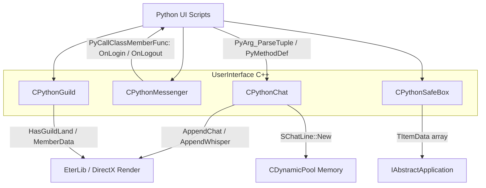

# Dokumentacja Techniczna: Moduly 'chat', 'messenger', 'guild' i 'safebox' (UserInterface)

## 1. Cel Architektoniczny i Rola Modulu
Moduly `chat`, `messenger`, `guild` i `safebox` pelnia role interfejsu pomiedzy mechanika gry C++ (C++ Client Game Logic / EterBase) a warstwa wizualna i skryptowa (Python UI) w grze (prawdopodobnie Metin2). Ich nadrzednym celem jest dostarczenie graczowi bezproblemowej obslugi funkcji spolecznosciowych (komunikacja, relacje) oraz zarzadzania prywatnym ekwipunkiem rozszerzonym (magazyn / safebox).
Moduly te rejestruja metody (przez makra PyMethodDef) wykorzystywane w interfejsie uzytkownika Python, wspolpracujac scisle z:
* **EterLib (DirectX)** - renderowanie tekstu (`CGraphicTextInstance`) dla czatu i szeptu.
* **CDynamicPool** (EterBase) - wydajna alokacja pamieci dla wielokrotnie powtarzajacych sie elementow jak obiekty czatu (linie) oraz szeptu (`CWhisper::SChatLine`, `CPythonChat::SChatLine`).
* **Python API** - poprzez modul PyCallClassMemberFunc, ktory dynamicznie wola metody UI, np. `OnLogin` czy `OnLogout` z instancji `CPythonMessenger`.

## 2. Diagram Architektury i Przeplywu Danych (Mermaid)

## 3. Rejestr Struktur Danych i Pamieci (Memory & Struct Layout)

### CPythonChat
* `enum EWhisperType` - Definiuje typy szeptow (np. `WHISPER_TYPE_CHAT=0`, `WHISPER_TYPE_SYSTEM=0xFF`).
* `enum EBoardState` - `BOARD_STATE_VIEW`, `BOARD_STATE_EDIT`, `BOARD_STATE_LOG`.
* `struct SChatLine`
  - `int iType` - typ komunikatu.
  - `float fAppendedTime` - stempel czasowy na podstawie `rApp.GetGlobalTime()`.
  - `D3DXCOLOR aColor[3]` - tablica z kolorami dla roznych stanow okien.
  - `CGraphicTextInstance Instance` - instancja obiektu graficznego DirectX dla renderowania tekstu.
  - Alokacja pamieci realizowana za pomoca `CDynamicPool<SChatLine> ms_kPool`.
* `struct TWaitChat`
  - `int iType`, `std::string strChat`, `DWORD dwAppendingTime`.
* `struct TChatSet`
  - Pozycje okna (`m_ix, m_iy, m_iHeight, m_iStep, m_fEndPos`).
  - Stan okna `m_iBoardState`.
  - Tryby wiadomosci `std::vector<int> m_iMode`.
  - Lista przypisanych wiadomosci `TChatLineList m_ShowingChatLineList`.

### CWhisper
* `struct SChatLine` - ubozsza wersja `SChatLine` z samego czatu, przechowujaca jedynie `CGraphicTextInstance Instance`. Alokacja pamieci rowniez poprzez pool: `CDynamicPool<SChatLine> ms_kPool`.

### CPythonMessenger
* `TFriendNameMap m_FriendNameMap` - zbior `std::set<std::string>` listujacy nicki uzytkownikow przyjaciol.
* `TGuildMemberStateMap m_GuildMemberStateMap` - mapa `std::map<std::string, BYTE>` statusow polaczenia czlonkow gildii.

### CPythonGuild
* `struct SGuildInfo` (TGuildInfo)
  - `DWORD dwGuildID`, `char szGuildName[GUILD_NAME_MAX_LEN+1]`, `DWORD dwMasterPID`, `DWORD dwGuildLevel`, `DWORD dwCurrentExperience`, `DWORD dwCurrentMemberCount`, `DWORD dwMaxMemberCount`, `DWORD dwGuildMoney`, `BOOL bHasLand`.
* `struct SGuildGradeData` (TGuildGradeData)
  - `BYTE byAuthorityFlag`, `std::string strName`.
* `struct SGuildMemberData` (TGuildMemberData)
  - `DWORD dwPID`, `std::string strName`, `BYTE byGrade`, `BYTE byJob`, `BYTE byLevel`, `BYTE byGeneralFlag`, `DWORD dwOffer`.
* `struct SGuildBoardCommentData` (TGuildBoardCommentData)
  - `DWORD dwCommentID`, `std::string strName`, `std::string strComment`.
* `struct SGuildSkillData` (TGuildSkillData)
  - `BYTE bySkillPoint`, `BYTE bySkillLevel[GUILD_SKILL_MAX_NUM]`, `WORD wGuildPoint`, `WORD wMaxGuildPoint`.

### CPythonSafeBox
* `TItemInstanceVector m_ItemInstanceVector` i `m_MallItemInstanceVector` - `std::vector<TItemData>`, wektory symulujace plaska tablice 2D dla `SAFEBOX_PAGE_SIZE` (45 slotow, 5x9).
* `DWORD m_dwMoney` - przechowywane srodki uzytkownika w magazynie.

## 4. Rejestr Klas i Metod (API Reference)

### CPythonChat
* `void AppendChat(int iType, const char * c_szChat)`
  - Algorytm: Tworzy lub wyciaga z pamieci `SChatLine` poprzez `SChatLine::New()`. Podpina obiekt instancji renderowania tekstu EterLib. Wpycha go na koniec kontenera `m_ChatLineDeque`. Pilnuje stalego limitu `CHAT_LINE_MAX_NUM = 300` i w razie przekroczenia obcina przod deki za pomoca `pop_front()`, uwalniajac pamiec z Poola.
* `void AppendWhisper(int iType, const char * c_szName, const char * c_szChat)`
  - Algorytm: Wyszukuje po `std::string` nazwy w `m_WhisperMap`. Jesli okna szeptu (CWhisper) nie ma, automatycznie inicjalizuje nowe zlecajac `CreateWhisper()`. Nastepnie wywoluje `CWhisper::AppendChat()`.
* `void IgnoreCharacter(const char * c_szName)` / `BOOL IsIgnoreCharacter(...)`
  - Algorytm: Uzywa `std::set<std::string> m_IgnoreCharacterSet` zeby przechowywac i sprawdzac czy imie postaci znajduje sie na czarnej liscie. Ogranicza wyswietlanie tekstu od nadawcy.

### CPythonMessenger
* `void OnFriendLogin(const char * c_szKey)` / `OnFriendLogout(...)`
  - Algorytm: Aktualizuje status gracza w mapach wewnetrznych, oraz asynchronicznie przerywa do UI przez wywolanie Python'a `PyCallClassMemberFunc(m_poMessengerHandler, "OnLogin", ...)` powiadamiajac interfejs graficzny, by np. zmienic kolor pseudonimu gracza z czarnego (wylogowany) na bialy (zalogowany).

### CPythonGuild
* `void RegisterMember(TGuildMemberData & rGuildMemberData)`
  - Algorytm: Sprawdza z pomoca `std::find_if` oraz struktury funktora `CPythonGuild_FFindGuildMemberByPID` czy uzytkownik jest w liscie `m_GuildMemberDataVector`. Jesli jest to podmienia jego wlasciwosci na podstawie argumentu i na koniec aktualizuje sredni poziom wszystkich uzytkownikow `__CalculateLevelAverage()` oraz sortuje `__SortMember()`.
* `BOOL IsMainPlayer(DWORD dwPID)`
  - Algorytm: Sprawdza czy dany czlonek gildii (identyfikowany przez PID) ma ta sama nazwe co lokalny uzytkownik pobrany przez `IAbstractPlayer::GetSingleton().GetName()`.

### CPythonSafeBox
* `void OpenSafeBox(int iSize)`
  - Algorytm: Resetuje wszystkie dane magazynu, uzywajac `m_ItemInstanceVector.clear()` a nastepnie wykonujac `.resize(SAFEBOX_SLOT_X_COUNT * iSize)`. Inicjalizuje pamiec za pomoca `ZeroMemory` (zerujac strukture `TItemData`).

## 5. Punkty Styku (Cross-Subsystem Integration)
* **Python Integration**: Modul eksponuje funkcje C-like do Pythona w pliku `PythonChatModule.cpp` (i podobnych dla reszty modulow). Metody Pythona sa mapowane poprzez makra `PyMethodDef`, w stylu:
  `{ "AppendChat", chatAppendChat, METH_VARARGS }`. Parametry takie jak `c_szChat` pobierane sa za pomoca wywolan `PyTuple_GetString(poArgs, 1, &szChat)`.
* **Python Handler Calls**: `CPythonMessenger` uzywa `PyCallClassMemberFunc` aby uruchomic metody na instancji zarzadcy zdarzen w UI (zarejestrowanej jako obiekt `m_poMessengerHandler`).
* **DirectX i VRAM**: Klasy takie jak `CWhisper` oraz instancja linii w okienku chat posiadaja kluczowe uzaleznienie od `CGraphicTextInstance`. Przy renderowaniu poszczegolnej linii wywolywana jest funkcja `pChatLine->Instance.Render(&Rect)` na uprzednio zadeklarowanych czcionkach, ktora deleguje rasteryzacje bezposrednio do VRAM w backendzie sprzetowym `EterLib`.

## 6. Pulapki, Antywzorce i Ograniczenia
* **Hardcoded Limits**: Limit deki czatu ustalono na sztywno na `CHAT_LINE_MAX_NUM = 300` zarowno dla `m_ChatLineDeque` jak i `m_ShowingChatLineList`. Powoduje to wymuszone kasowanie historii w zatloczonych miastach przy nadmiarze szeptow badz spamie na chacie (potencjalna utrata waznych powiadomien systemowych).
* **Zaleznosc na D3DX**: Przeplyw chat'u przechowuje kolory `D3DXCOLOR`. Jakiekolwiek zanikanie urzadzenia (`D3DERR_DEVICELOST`) z EterLib moze wymagac niszczenia lub odtwarzania setki poolowanych, widocznych elementow tekstowych w oknie chat'u i whisperze.
* **Mem-leak przy niezamknieciu gry (PythonChat::Destroy())**: Pamiec z `CDynamicPool` (zjawisko na stertach Pool_ms_kPool) nie zostaje automatycznie zwrocona do SO przy standardowym destruktorze `std::deque`. Aplikacja musi manualnie uruchamiac `SChatLine::DestroySystem()`.
* **String Comparisons in Update Loop**: Uzywanie `std::find_if` w operacjach `m_GuildMemberDataVector` oraz ciagle wyszukiwanie lancuchow w funkcjach poslugujacych sie wskaznikami ciagow tekstowych np. `CPythonGuild_FFindGuildMemberByName` powoduje spowolnienie przy gigantycznych gildiach, a takze spora fragmentacje przez dynamicznie zmieniajace sie pakiety asynchroniczne i wielokrotnie uzywanie metody kopii mapowanej mapy szeptow (`m_WhisperMap.insert`).

